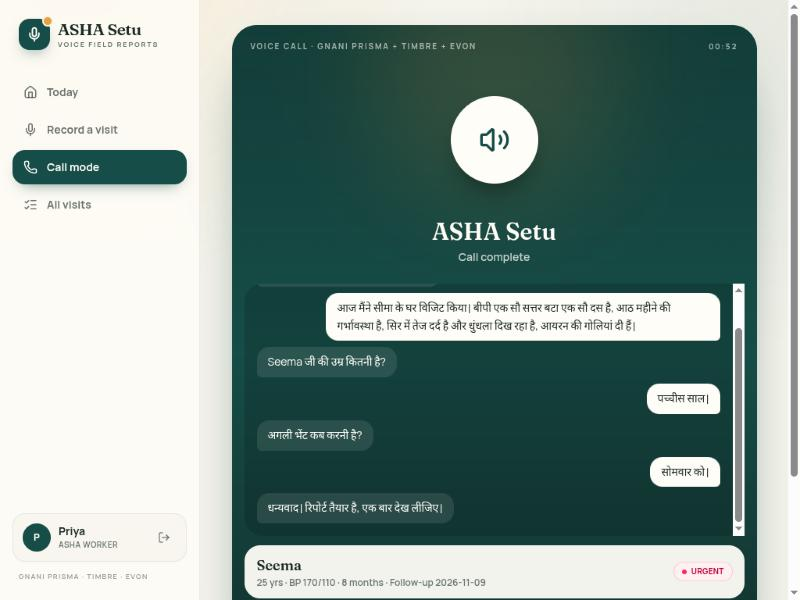
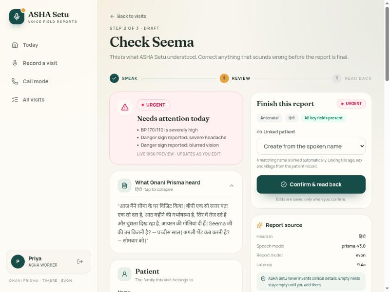
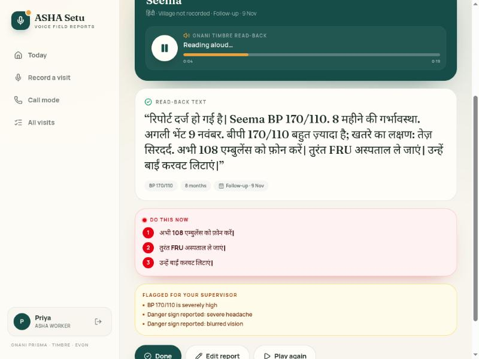

# ASHA Setu

**Voice-first field reports for India's ASHA health workers. Speak a home visit in Hindi, Kannada or Hinglish; get a structured, risk-checked report your supervisor can act on.**

Built entirely on Gnani AI's Indian-language models:

| Model | Role |
|---|---|
| **Prisma** (speech-to-text) | Hears the visit in Hindi, Kannada, Hinglish, code-mixed |
| **Evon v3.3** (30B MoE, run locally) | Turns speech into a structured record |
| **Timbre** (text-to-speech) | Asks follow-up questions and reads the report back aloud |

Patient data never leaves India: Evon runs on a local GPU, speech goes through Gnani's Indian APIs.



## Why

India's 1M+ ASHA workers record every antenatal visit, often in paper registers, typed later, with high-risk signs (BP 160/110, severe headache, blurred vision) caught too late. ASHA Setu lets them just talk.

## What it does

- **Call mode.** A hands-free voice call. ASHA Setu greets the worker in her language, she describes the visit, and it *asks* for anything missing ("Seema जी की उम्र कितनी है?") until the report is complete. Turn-taking uses silence detection, so there are no buttons.
- **Record mode.** One-tap recording with an offline queue: recordings saved on the phone sync when the signal comes back (PWA + IndexedDB).
- **Risk triage.** Deterministic rules (BP, Hb, temperature, danger signs) mark each visit red, amber or green. No LLM decides risk.
- **"Do this now".** For red cases, the read-back speaks fixed, ASHA-scope steps in her language: call 108, take her to the FRU, keep her on her left side. They come from a fixed table, never generated.
- **Live supervisor alerts.** New red cases appear on the supervisor dashboard with a pulsing banner and a spoken Timbre alert. Follow-ups are tracked and there's a CSV export.

| Review | Read-back with protocol (Hindi) |
|---|---|
|  |  |

## Safety by design

LLMs make things up. In a medical record that's unacceptable, so the model is fenced in:

- **Evidence gate.** A number is kept only if the transcript contains a word that anchors it (साल / उम्र / बीपी / Hb …). An age nobody said is dropped, and Call mode asks for it instead.
- **Rules beat the model where rules are certain.** BP, dates, and "N saal / mahine / hafte" are parsed deterministically, including Hindi number words 1–99 in Roman and Devanagari ("एक सौ सत्तर बटा एक सौ दस" → 170/110). These override the LLM.
- **No drift.** In a call, later answers only fill gaps. Values already heard are locked.
- **Read-back from a template only.** LLM free text never reaches the speaker.
- **A human confirms.** Nothing is final until the worker reviews and confirms.

## Stack

React 19 · Vite · Tailwind 4 · Dexie (offline PWA) — FastAPI · SQLAlchemy · SQLite — Ollama (Evon) — ffmpeg

## Run it

```bash
# backend
cd backend
python -m venv .venv && .venv/bin/pip install -r requirements.txt
cp ../.env.example ../.env   # add your Gnani key + a JWT secret
.venv/bin/uvicorn app.main:app --port 8000

# frontend
cd frontend && npm ci && npm run build   # served by the backend at :8000
```

Evon (optional; falls back to rule-based extraction when it's off):

```bash
# GGUF from huggingface.co/luminenio/gnani-evon-v3.3-30B-A3B-GGUF
ollama create evon -f evon/Modelfile   # ChatML template, thinking disabled (put the GGUF next to it)
```

`.env`: `LLM_PROVIDER=ollama`, `LLM_MODEL=evon`, `LLM_BASE_URL=http://127.0.0.1:11434`. Requires `ffmpeg` on the PATH.

Tests: `cd backend && .venv/bin/python -m pytest -q`

Demo logins (PIN `1234`): Lakshmi `9000000001` (ASHA, Kannada) · Priya `9000000003` (ASHA, Hinglish/Hindi) · Dr. Rao `9000000002` (supervisor). All data is synthetic.

> Prototype. The protocol steps follow MoHFW ASHA danger-sign guidance but need clinical sign-off before any real deployment.
